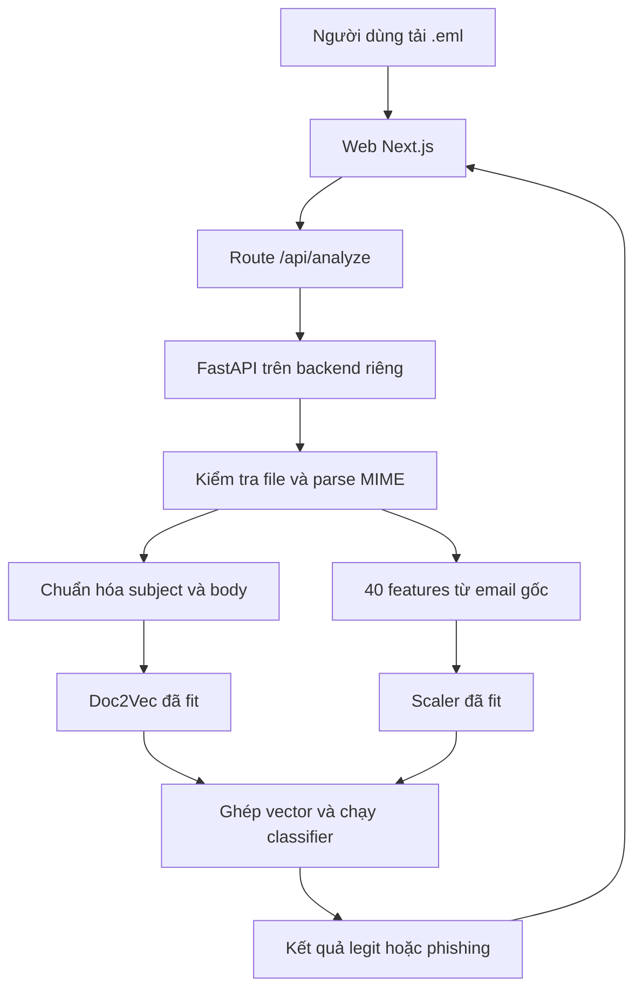

# Kế hoạch xây dựng web application IAP

Ngày lập: 05/10/2026. Cập nhật theo Graph_IAP419t và yêu cầu kết quả hai nhãn: `legit` / `phishing`. Đây là kế hoạch triển khai, chưa phải ứng dụng đã được xây dựng hoặc kiểm thử.

## 1. Phạm vi đã chốt

Người dùng chọn:
- Đưa email vào ứng dụng bằng cách tải hoặc kéo-thả file `.eml`.
- Frontend Next.js và mô hình Python chạy ở backend riêng; bản hiện tại chạy local, hosting chưa được chọn.
- Ưu tiên các gói hosting miễn phí.
- Kết quả phân loại trên web chỉ gồm hai nhãn: `legit` hoặc `phishing`.

Mục tiêu bản đầu: người dùng đưa vào một file `.eml`, ứng dụng xử lý bằng pipeline ML của project và hiển thị một kết quả `legit` hoặc `phishing` khi phân tích thành công.

Đề xuất làm một ứng dụng demo nghiên cứu dùng được từ đầu đến cuối. Probability score, detected indicators, email inspector, bảng 40 features, export JSON và trang thông tin model là phần mở rộng, không phải điều kiện hoàn thành bản đầu. Gmail API, Chrome extension, tài khoản người dùng, quét hàng loạt, lịch sử lưu trên server, cơ sở dữ liệu và tự động xử lý hộp thư cũng nằm ngoài MVP.

Thời lượng phần web dự kiến: khoảng 15 ngày làm việc, tương đương 3 tuần nếu nhóm làm đều. Ước lượng này giả định có model thật với target `legit` / `phishing` và môi trường tương thích. Model được báo cáo hiện có positive class gộp spam/phishing, nên không mặc định đã đạt điều kiện này. Nếu cần rà soát nhãn hoặc train lại, thời gian phần ML phải được ước lượng riêng sau khi kiểm kê dữ liệu.

### 1.1. Đối chiếu với Graph_IAP419t

Đã xem ảnh đính kèm `Graph_IAP419t.drawio (1)(1).png`, có tiêu đề EMAIL THREAT DETECTION. Các điểm dưới đây đối chiếu đúng ảnh này; không giả định có một file drawio khác đã được sửa.

| Khối trong sơ đồ | Mức phù hợp của kế hoạch | Điều chỉnh theo yêu cầu hiện tại |
| --- | --- | --- |
| Input: submit email `.eml` | Khớp | Giữ upload/kéo-thả một file |
| Preprocessing: MIME parser, clean text | Khớp | Giữ parse MIME trước; text sạch dành cho Doc2Vec |
| Feature fusion: 40 features + Doc2Vec, concatenate | Khớp | Giữ 40 features; thêm bước dùng scaler đã fit trước concatenate |
| Classification: một trained model được chọn | Khớp | Giữ một classifier; xác minh target là legit/phishing |
| Results: Legitimate, Spam, Phishing | Chưa khớp yêu cầu hai nhãn | Đổi khối Results thành Legit và Phishing; loại nhãn Spam |
| Probability, detected indicators, email inspector | Rộng hơn MVP | Đưa ra khỏi giao diện bắt buộc; có thể thêm sau |
| Offline training: train/validation/test, compare/select | Khớp định hướng, code hiện tại còn thiếu bước cần thiết | Rà soát nhãn, thêm validation khi chọn model/ngưỡng và đánh giá đúng target |
| Web application: frontend, backend, model + results storage | Khớp frontend/backend; storage cần diễn đạt lại | Bắt buộc lưu artifacts model; kết quả chỉ ở phiên người dùng, chưa cần database |

Sơ đồ cũng cần cập nhật khối Results và nhãn training để diễn đạt đúng yêu cầu hai lớp. Kế hoạch này cập nhật phạm vi sản phẩm; chưa chỉnh sửa chính file hình/sơ đồ.

## 2. Những gì đã xác minh từ project và báo cáo

| Thành phần | Hiện trạng đã đọc | Hệ quả cho kế hoạch |
| --- | --- | --- |
| `load_data.py` | Loader dành cho dataset nghiên cứu; `INCLUDE_SPAM = True`; giữ nhãn số 0/1 của CSV | Không gọi loader dataset trong request upload |
| `preprocess.py` | `FEATURE_NAMES` chứa 40 engineered features thuộc 6 nhóm | Tái sử dụng đúng hàm và đúng thứ tự features |
| `train.py` | Fit Doc2Vec và scaler trên training set; ghép vector rồi train 10 classifiers | Tách training offline với inference online |
| `evaluate.py` | Tạo bảng so sánh, confusion matrix và ROC; cột AUC CSV hiện dùng hard predictions | Không đưa cột AUC đó lên web như AUC tính từ scores |
| API và giao diện | Không thấy FastAPI/Flask app, frontend, upload endpoint hoặc inference service trong các file nguồn của ZIP | Cần xây mới lớp sản phẩm và adapter inference |
| Model và test arrays | 12 file `.pkl` cùng hai file `.npy` trong ZIP là Git LFS pointers | Chưa thể chạy prediction từ chính các bytes đính kèm |
| Dependencies | `requirements.txt` chưa khóa phiên bản | Cần lấy thông tin môi trường train và tạo lockfile |
| Tài liệu cũ | README nói 42 features/142 chiều; code hiện có 40 features | Sửa tài liệu phục vụ web theo code và model thật |
| Nhãn | Class 1 hiện gộp phishing và ordinary spam | Cần model target legit/phishing trước khi trả hai nhãn theo yêu cầu; không chỉ đổi tên class 1 |
| Ngôn ngữ | Bảo toàn Unicode; keyword và stopword chủ yếu tiếng Anh | Chưa có cơ sở công bố hiệu quả với email tiếng Việt |

Các nhóm engineered features hiện có:

| Nhóm | Số lượng |
| --- | ---: |
| Content/NLP statistics | 7 |
| URL | 11 |
| Sender/header | 6 |
| HTML/structure | 6 |
| Attachment properties | 5 |
| Social engineering | 5 |
| Tổng | 40 |

Doc2Vec dự kiến 100 chiều, nên đầu vào dự kiến là 140 chiều. Lúc lấy model thật phải kiểm tra `vector_size`, `scaler.n_features_in_` và `classifier.n_features_in_`; không dùng số trong comment để thay cho kiểm tra.

## 3. Kết quả hai nhãn và điều kiện về dữ liệu

Hợp đồng sản phẩm: mỗi lần phân tích thành công trả đúng một trong hai nhãn:

| Target đã xác minh của model | Giá trị API | Giao diện |
| --- | --- | --- |
| Class 0: legitimate email | `legit` | Legit |
| Class 1: phishing email | `phishing` | Phishing |

Giao diện chính chỉ cần tên file và nhãn phân loại. Probability, phần trăm confidence, mức độ rủi ro, nhãn Spam và danh sách dấu hiệu không thuộc MVP. Backend vẫn dựng đầy đủ 40 features và vector Doc2Vec để suy luận; việc đơn giản hóa giao diện không thay đổi representation.

Lỗi file, thiếu nội dung để suy luận, model chưa sẵn sàng hoặc timeout là trạng thái xử lý. Chúng không phải một lớp email thứ ba. Khi gặp lỗi, không trả `legit` hoặc `phishing` giả để ép đủ hai nhãn.

### 3.1. Không đổi tên nhãn của model mixed positive

Code đính kèm có `INCLUDE_SPAM = True` và giữ nhãn numeric 0/1 từ CSV. Vì vậy, class 1 của model hiện được báo cáo không đồng nghĩa với phishing. Chỉ thay chuỗi hiển thị class 1 thành `phishing` sẽ không tạo ra detector đúng target.

Điều kiện trước khi nối prediction thật:
1. Xác minh dataset snapshot và quy ước nhãn mà model thực sự đã dùng; không chỉ xem `classes_ = [0, 1]`.
2. Dựng training/evaluation target: class 0 có nhãn legitimate được kiểm tra; class 1 có nhãn phishing được nguồn hoặc review xác nhận.
3. Mặc định loại ordinary spam và positive records chưa xác định khỏi benchmark legit/phishing. SpamAssassin ham vẫn có thể là ứng viên class 0 theo provenance; nhãn spam không tự trở thành phishing. Record spam chỉ dùng làm positive khi có bằng chứng riêng xác nhận phishing.
4. Rà soát từng nguồn CSV. Numeric 1 và tên thư mục `phishing` không đủ chứng minh record là phishing. Đặt `INCLUDE_SPAM = False` riêng lẻ không loại hết numeric positives có nguồn spam.
5. Nếu target của artifacts thật vẫn là mixed positive, tạo release train/evaluate mới cho target hai lớp. Lưu manifest và kết quả mới; không tái sử dụng metrics cũ như metrics phishing-only.

Ở phạm vi mặc định này, `legit` nghĩa là legitimate trong dataset đã review, không tự động mở rộng thành toàn bộ non-phishing email gồm ordinary spam. Nếu sau này muốn bao phủ spam không có phishing trong lớp âm, cần định nghĩa lại target và đưa dữ liệu đó vào đánh giá.

Nếu model phù hợp chưa có, có thể xây UI/API contract với fixtures được đánh dấu là mẫu. Model mixed positive chưa đạt điều kiện để nghiệm thu chức năng trả kết quả legit/phishing thật.

## 4. Kiến trúc đề xuất

### 4.1. Stack

| Phần | Lựa chọn đề xuất | Lý do |
| --- | --- | --- |
| Web UI | Next.js, TypeScript, Tailwind CSS | Một codebase cho UI và route chuyển tiếp |
| Route chuyển tiếp | Next.js route handler | Giữ token gọi backend ở server, chuẩn hóa upload và lỗi |
| ML API | FastAPI | Giữ pipeline Python; schema và OpenAPI rõ ràng |
| Môi trường backend | Docker, một Uvicorn worker ban đầu | Khóa môi trường và tránh nhân nhiều bản model trong RAM |
| Backend hosting | Chưa chọn; cần kiểm tra tương thích và tài nguyên | Demo hiện tại dùng backend local |
| Lưu dữ liệu | Xử lý theo request, kết quả ở bộ nhớ trình duyệt trong phiên | Bản đầu chưa cần database |
| Quản lý source | Git repository của nhóm; thay đổi theo story | Review và rollback từng phần |
| Kiểm thử | Pytest cho inference/API; Playwright cho luồng upload | Kiểm tra ranh giới dễ hỏng khi nối ML vào web |

Sử dụng phiên bản thư viện cụ thể sau khi kiểm tra môi trường thật. Không mặc định nâng toàn bộ Python/ML packages lên phiên bản mới nhất vì pickle cũ có thể không tương thích.

### 4.2. Luồng request



Các features URL/header/HTML/attachment phải lấy từ email gốc trước khi clean text. Bộ scaler và Doc2Vec phải thuộc cùng release với classifier. Release dùng cho luồng này phải có target legit/phishing đã xác minh theo mục 3.

### 4.3. Hosting và vận hành local

Mục tiêu peak RAM khoảng 400 MiB trong PRD vẫn là mục tiêu nghiên cứu tương lai chưa được kiểm chứng, không phải giới hạn bộ nhớ hay cam kết cho demo legacy local hiện tại. Chưa có kết quả đo xác nhận mục tiêu này.

Bản hiện tại chạy frontend Next.js và backend Python riêng trên loopback. Chưa chọn nhà cung cấp hosting. Yêu cầu dọn dẹp ngày 19/10/2026 thay thế lựa chọn triển khai trước đây; việc này không xác nhận các yêu cầu sản phẩm hoặc điều kiện E0 chưa được kiểm chứng.

Giới hạn upload là 2 MiB cho toàn bộ file `.eml`, gồm attachment đã mã hóa. Mỗi request chỉ nhận một file; kiểm tra byte thực tế của cả multipart tại frontend, proxy và backend.

Nếu chọn hosting trong tương lai, phải đo RAM toàn bộ supervisor/worker, startup, warm/cold latency, upload gần giới hạn, deadline, recovery và tính bền vững của model đã xác minh. Kích thước pickle không chứng minh RAM runtime. Giữ một worker; mọi tối ưu model hoặc dependencies cần bằng chứng parity. Frontend/proxy và backend phải liên lạc được; localhost chỉ dùng cho các tiến trình trên cùng máy.

Không tự chọn gói trả phí, GPU, database hoặc keepalive cron. Demo local không chứng minh khả năng vận hành cloud. Giữ model/code/resources/policy cùng release khi nâng cấp hoặc rollback.

## 5. Chọn model để phục vụ web

XGBoost là ứng viên kỹ thuật ban đầu để thử đóng gói:
- Bảng kết quả lưu trong project ghi Accuracy 93.38%, Precision 88.62%, Recall 81.98%, F1 85.17%.
- Trong bảng đó, XGBoost có F1 cao nhất.
- File classifier riêng có kích thước object khai báo nhỏ; vẫn cần Doc2Vec và scaler.

Các số trên thuộc benchmark mixed positive cũ. Chúng là thông tin tham chiếu, chưa phải kết quả trên target legit/phishing mới. Việc chọn classifier để nghiệm thu cần dựa trên đánh giá target mới; không mặc định XGBoost vẫn có F1 cao nhất sau khi sửa nhãn.

Bản đầu chỉ load một bộ artifacts cùng release đã đáp ứng target legit/phishing. Nếu chọn XGBoost, bộ này gồm:
- `model_dbow.pkl` — tên file hiện có; phải xác minh cấu hình Doc2Vec thật.
- `feature_scaler.pkl`.
- `XGBoost.pkl`.
- Release manifest ghi phiên bản, hashes và preprocessing configuration.

Mười classifiers tiếp tục phục vụ nghiên cứu offline. Web không cần chạy cả mười cho mỗi upload.

Manifest cần tối thiểu: release ID, tên và hash từng artifact, source commit, Python/package versions, FEATURE_NAMES đúng thứ tự, vector size, class mapping, target `legit_vs_phishing`, provenance/review của nhãn, stopword/lemmatization configuration, inference parameters và quy tắc quyết định nhãn. Backend chỉ sẵn sàng phục vụ chức năng này khi provenance xác nhận đúng target; tên file và class IDs không thay thế thông tin đó.

Nếu lấy model từ repo thật, bước thao tác dự kiến ở repo của nhóm là `git lfs pull`. Kiểm tra bytes tải về không còn bắt đầu bằng `version https://git-lfs.github.com/spec/v1`. Nếu không lấy được, nhóm phải tái tạo artifacts và giữ riêng kết quả của lần train mới.

Nếu retrain, cần kiểm tra thêm các vấn đề hiện thấy trong code: Doc2Vec chưa khai báo rõ mode/vector size, tags dùng hai class labels, vòng lặp tự giảm alpha. Các thay đổi này thuộc một experiment mới; không gán kết quả CSV cũ cho model đã sửa.

## 6. Các màn hình bản đầu

| Màn hình/vùng | Nội dung | Tiêu chí |
| --- | --- | --- |
| Upload | Kéo-thả hoặc chọn một file .eml; tên, kích thước; nút Phân tích | Chặn file sai định dạng, rỗng hoặc quá giới hạn; có hướng dẫn xuất email |
| Đang phân tích | Các trạng thái gửi file, backend đang khởi động, đang phân tích | Không hiển thị phần trăm tiến độ giả; có timeout và thử lại có giới hạn |
| Kết quả | Tên file và một nhãn Legit hoặc Phishing | API và giao diện chỉ có hai nhãn khi phân tích thành công |
| Lỗi xử lý | Thông báo file không hợp lệ, thiếu nội dung, model chưa sẵn sàng hoặc timeout | Có thao tác chọn lại file/thử lại; không gán nhãn khi chưa suy luận thành công |

Giao diện đề xuất: một trang làm việc với khu upload và khu kết quả. Hiển thị trạng thái bằng chữ, không chỉ màu. Metadata của model, features và thời gian xử lý được giữ cho kiểm thử nội bộ, không bắt buộc xuất hiện trên giao diện.

Email inspector, probability score, detected indicators, bảng features, trang model-info và export JSON chỉ được thêm khi có yêu cầu mở rộng. Nếu thêm inspector, nội dung email phải render theo text đã xử lý và không chạy HTML/script hoặc tải ảnh theo dõi.

Bản đầu không cần dashboard thống kê tổng số “phishing đã ngăn chặn”; ứng dụng chưa có bằng chứng hoặc hành vi xử lý thư để đo con số đó.

## 7. Hợp đồng API cần thống nhất trước khi coding giao diện thật

| Endpoint | Bên phục vụ | Trách nhiệm |
| --- | --- | --- |
| `POST /api/analyze` | Next.js | Nhận multipart, kiểm tra file, gọi backend bằng server-side token |
| `POST /v1/analyze` | FastAPI | Parse .eml, dựng vector, chạy model phù hợp và trả nhãn legit/phishing |
| `GET /health/live` | FastAPI | Process đang sống; trả ít thông tin |
| `GET /health/ready` | FastAPI | Model/corpora đã sẵn sàng; trả 503 khi chưa sẵn sàng |

Response thành công tối thiểu:

```json
{
  "analysis_status": "completed",
  "label": "phishing"
}
```

`label` có enum đúng hai giá trị `legit` và `phishing`. `analysis_status` là trạng thái request, không phải lớp email. Không cần trả probability, indicators, raw email hoặc 40 feature values cho frontend. Model release ID, features và timing vẫn có thể được kiểm tra nội bộ mà không log nội dung email.

`GET /model-info` là endpoint mở rộng khi có nhu cầu; không bắt buộc cho MVP.

Lỗi dùng cấu trúc thống nhất: `error.code`, `error.message`, `request_id`. Các trường hợp cần nghiệm thu: file rỗng, không phải email phù hợp, quá kích thước, model chưa sẵn sàng, request bận, backend không liên lạc được, timeout.

Hướng status HTTP đề xuất: 400/422 cho input không phù hợp, 413 cho quá giới hạn, 429 hoặc 503 khi quá tải, 503 khi model chưa sẵn sàng và 504 khi upstream timeout. Không trả stacktrace cho người dùng.

Giữ quy tắc prediction của classifier đã xác minh đúng target. Nếu chọn threshold tùy chỉnh, chọn trên validation riêng và ghi phiên bản; không chọn sau khi nhìn test set. MVP không có nhãn “chưa chắc chắn”; thất bại xử lý được trả bằng response lỗi, không bằng một nhãn phân loại mới.

## 8. Thứ tự triển khai và nghiệm thu

### E0 — Xác minh target hai lớp, artifacts và môi trường ML

Dự kiến 1–2 ngày để kiểm kê và thử artifacts đã có. Nếu cần sửa nhãn/train lại, lập ước lượng riêng cho phần đó; E0 không mặc định hoàn thành trong hai ngày. Đây là mốc phụ thuộc quan trọng của prediction thật.

Công việc:
1. Kiểm kê model thật, Dataset thật nếu cần retrain, environment/versions trên máy train.
2. Load riêng ba artifacts cần dùng trong một môi trường tương thích.
3. Xác minh training target, provenance của nhãn, class mapping và kích thước đầu vào. Các artifacts mixed positive chưa đáp ứng target legit/phishing.
4. Làm bộ email thử đã loại dữ liệu cá nhân: plain text, HTML, multipart, charset khác nhau, có attachment và malformed.
5. Chạy một harness inference tối thiểu; ghi RAM, startup và latency.
6. Nếu target chưa đúng, dựng benchmark legit/phishing theo mục 3, train/evaluate release mới và lưu kết quả riêng. Dùng validation khi chọn model/ngưỡng; giữ test độc lập theo nhóm email.
7. Chốt model release có class 0 legitimate/class 1 phishing, metadata target và cấu hình preprocessing.

Nghiệm thu:
- Model không còn là LFS pointer.
- Có bằng chứng training/evaluation target là legitimate/phishing; spam không được gộp làm positive chỉ theo nhãn spam/numeric 1.
- Một .eml chạy được từ bytes tới prediction thật.
- 40 features và kích thước hybrid khớp artifacts.
- Có manifest target, đánh giá đúng target và kết quả benchmark tài nguyên sơ bộ.
- Nếu artifacts chưa sẵn sàng, mọi fixture UI được ghi rõ là mẫu giao diện.

### E1 — Chốt yêu cầu và UX bằng BMAD

Dự kiến ngày 3; có thể chuẩn bị khi E0 đang xử lý.

Công việc:
1. Cho BMAD/Codex đọc project hiện hữu và báo cáo.
2. Ghi phạm vi .eml, hosting miễn phí, output chỉ legit/phishing và điều kiện target của model.
3. Chốt PRD ngắn, luồng upload/kết quả/lỗi.
4. Ghi architecture và API contract.
5. Chia stories đủ nhỏ và có acceptance criteria.

Nghiệm thu:
- Mỗi tính năng có đầu vào, đầu ra và tiêu chí kiểm tra.
- Một quyết định chung cho labels, request size, model version và error states.
- Probability/indicators/inspector/export không nằm trong acceptance criteria của MVP.
- Tài liệu không mô tả Gmail, extension hoặc model explanation là chức năng đã có.

### E2 — Đóng gói inference và làm FastAPI

Dự kiến ngày 4–6.

Công việc:
1. Tạo adapter inference dùng preprocessing chung với training.
2. Khai báo rõ corpora, stopword và lemmatization; không download NLTK trong request.
3. Load model một lần khi startup; không import hoặc chạy `train.py`.
4. Tạo endpoint và response schema chỉ trả nhãn legit/phishing khi suy luận thành công; kiểm tra target metadata lúc startup.
5. Tạo Docker image inference với lockfile.
6. Kiểm soát concurrency và thời gian xử lý.

Nghiệm thu:
- CLI/harness và API xử lý cùng .eml có features khớp, prediction phù hợp.
- Có test MIME/Unicode/HTML/attachment và lỗi input.
- Dùng `scaler.transform`, `Doc2Vec.infer_vector`; không fit lại từ email upload.
- Kiểm tra `classes_` và ánh xạ nhãn đúng target. Nếu cần probability để threshold nội bộ, lấy đúng class index; không bắt buộc trả score lên UI.
- Startup hỏng artifact/configuration phải fail rõ và readiness không báo sẵn sàng.

Doc2Vec inference có yếu tố ngẫu nhiên. Cần kiểm tra repeated requests và xử lý RNG/concurrency để nhãn không thay đổi tùy thứ tự request; nếu có sai khác vector, ghi tolerance và phương pháp kiểm tra.

### E3 — Xây frontend và nối dữ liệu thật

Dự kiến ngày 7–9.

Công việc:
1. Tạo Next.js app, layout và upload.
2. Nối route server với FastAPI.
3. Hiển thị tên file và kết quả Legit hoặc Phishing.
4. Bổ sung trạng thái thiếu dữ liệu, lỗi, đang khởi động và retry.
5. Nghiệm thu luồng upload, kết quả và lỗi; giữ các phần inspector/score/export ở backlog mở rộng.

Nghiệm thu:
- Upload một .eml đi hết luồng tới model thật.
- Không trộn kết quả file cũ với file mới; không cho gửi trùng trong lúc đang xử lý.
- Trình duyệt không nhận backend token.
- Nội dung file được gửi tới parser/inference; UI không render HTML hoặc mở attachment trong MVP.
- API trả đúng enum hai nhãn; metadata nội bộ truy được release đã dùng.

### E4 — Kiểm tra tài nguyên và hosting miễn phí

Dự kiến ngày 10–11.

Công việc:
1. Chạy container dưới giới hạn RAM; thử email sát ngưỡng kích thước.
2. Demo hiện tại chạy local; hosting tương lai cần được chọn và kiểm chứng riêng.
3. Cấu hình frontend và server route local; hosting tương lai cần quyết định riêng.
4. Đặt env vars và kết nối HTTPS.
5. Thử warm request, request sau khi backend ngủ, và backend đang không sẵn sàng.
6. Nếu hosting tương lai không đạt yêu cầu, ghi kết quả đo và giữ phương án demo local ở mục 4.3.

Nghiệm thu:
- Có URL frontend và backend hoạt động hoặc quyết định dự phòng có lý do đo được.
- Model có sẵn trong release/image hoặc được lấy bằng cơ chế có checksum; restart không làm mất bộ model.
- Upload .eml không được lưu lâu dài trên filesystem.
- UI xử lý được response startup không phải JSON từ nhà cung cấp.
- Không chọn plan trả phí hoặc thêm database chỉ để hoàn thành demo.

### E5 — Kiểm thử tích hợp và hoàn thiện bảo vệ

Dự kiến ngày 12–15.

Công việc:
1. Chạy end-to-end từ browser với bộ fixture và model thật.
2. Thử file rỗng, lớn, sai extension, email malformed, backend timeout, thiếu model.
3. Kiểm tra nội dung nhạy cảm không xuất hiện trong logs.
4. Đo latency warm/cold riêng; ghi số request, kích thước và môi trường.
5. Viết hướng dẫn chạy local, deploy, rollback và kịch bản demo.
6. Đối chiếu mô tả trên web với báo cáo nghiên cứu.

Nghiệm thu:
- Build frontend, tests inference/API và end-to-end quan trọng đều qua.
- README và model manifest đủ để thành viên khác chạy lại.
- Có bản demo Docker local dự phòng đã thử.
- Không coi upload thành công hoặc vài email demo là bằng chứng độ chính xác phishing.

Việc chứng minh model đúng target legit/phishing là điều kiện E0 của chức năng prediction theo yêu cầu mới. Điều này không tự hoàn tất toàn bộ RQ2/RQ3: ablation và independent-source test vẫn cần các experiment riêng. Báo cáo phải cập nhật kết quả của release mới, không thay tên target trên bảng benchmark cũ.

## 9. Phối hợp BMAD và Codex

BMAD tổ chức yêu cầu, quyết định và stories; Codex đọc code, thực hiện thay đổi, chạy kiểm tra và sửa lỗi. Khi BMAD chạy trong Codex, đó là workflow hướng dẫn Codex, không phải hai hệ thống cần gọi API qua lại.

Bước đầu tiên là kiểm tra phiên bản BMAD đang cài. ZIP đính kèm không có cấu hình BMAD để xác định phiên bản. Dùng catalogue và tài liệu của installation thực tế; không trộn command của các đời khác nhau.

Tài liệu chính thức đang truy cập ngày 05/10/2026 mô tả các tên sau:

| Bước | Skill/workflow hiện được tài liệu mô tả | Đầu vào cho project IAP |
| --- | --- | --- |
| Kiểm tra setup | `bmad`; yêu cầu `bmad status` | Thư mục repo và installation hiện có |
| Context repo | `bmad-project-context` | Code hiện hữu, Graph_IAP419t, target hai lớp, artifact limits và quy tắc inference |
| Yêu cầu | `bmad-prd` | Phạm vi .eml và user flow |
| UX | `bmad-ux` | Upload, nhãn Legit/Phishing, lỗi và trạng thái khởi động |
| Kiến trúc | `bmad-architecture` | Next.js, Python backend, API và tài nguyên |
| Hợp đồng triển khai | `bmad-spec` | Capabilities, constraints, non-goals và success signal |
| Chia và theo dõi stories | `bmad-ticket` | Spec và thứ tự phụ thuộc E0–E5 |
| Thực hiện một story | `bmad-build` trong Codex | Story, spec, code và acceptance criteria |
| Review | `bmad-code-review` | Diff, tests và tiêu chí của story |

Tài liệu hiện tại đánh dấu workflow cũ `bmad-document-project` là deprecated. Nếu bản BMAD của nhóm vẫn dùng workflow đời cũ, đối chiếu mục đích từng bước với những gì bản đó cung cấp; không bắt buộc nâng phiên bản giữa dự án.

Với ứng dụng này, PRD và architecture chỉ cần đủ ngắn để giữ các quyết định chung nhất quán. Không cần tạo một bộ tài liệu enterprise dài trước khi kiểm tra được model.

Cách chạy mỗi story:
1. Đưa một story và acceptance criteria vào một phiên Codex.
2. Codex đọc code/context, đề xuất phần sẽ thay đổi, thực hiện và kiểm tra.
3. Review diff và hành vi theo tiêu chí, sửa findings.
4. Cập nhật trạng thái và commit; phiên sau đọc lại context và story tiếp theo.

Có thể làm UI với fixture trong lúc chờ model, nhưng fixture phải được gắn nhãn. Khi E0 chưa qua, không gọi đó là demo AI đã tích hợp.

## 10. Prompt để bắt đầu trong Codex/BMAD

```text
Hãy đọc repo IAP491t hiện tại và Report_FA26IA05-C1(1).pdf trước khi lập yêu cầu.
Đối chiếu Graph_IAP419t.drawio; ảnh hiện có ba nhãn, nhưng yêu cầu sản phẩm là hai nhãn.

Mục tiêu: xây web application để người dùng tải/kéo-thả một file .eml và nhận
đúng một nhãn legit hoặc phishing khi phân tích thành công. Giữ pipeline parse MIME,
40 engineered features, scaler, Doc2Vec, concatenate và một classifier.
Frontend Next.js, backend Python riêng, hiện chạy local; hosting tương lai chưa chọn, ưu tiên miễn phí.
MVP chưa cần probability score, indicators, email inspector, export, Gmail API,
extension, tài khoản hoặc database.

Trước hết:
1. Kiểm tra phiên bản BMAD đang cài và workflow mà installation cung cấp.
2. Xác minh model_dbow.pkl, feature_scaler.pkl và XGBoost.pkl là model thật,
   không phải Git LFS pointers. Ghi package versions và preprocessing configuration.
3. Đối chiếu FEATURE_NAMES, vector_size, scaler và classifier; không mặc định
   theo README cũ ghi 42 features/142 chiều.
4. Xác minh training target: code hiện tại gộp spam/phishing vào class 1.
   Không chỉ đổi tên class 1 thành phishing. Nếu artifacts vẫn mixed positive,
   lập công việc rà soát nhãn/train/evaluate release legit/phishing trước khi nối model thật.
   XGBoost chỉ là ứng viên tham chiếu; bảng kết quả cũ không phải phishing-only metrics.
5. Tạo PRD ngắn, UX states, architecture, API contract và các stories theo kế hoạch.
6. Thực hiện story đầu tiên: kiểm kê nhãn/artifacts, kiểm tra target,
   harness inference và benchmark RAM/latency khi có release phù hợp.
   Chưa triển khai cloud trong bước này.

Khi implementation:
- Extract engineered features từ raw MIME trước cleanText.
- Dùng lại đúng Doc2Vec và scaler đã fit; không train từ file upload.
- Tách training offline với request inference.
- Kết quả phân loại chỉ là legit hoặc phishing; lỗi xử lý không phải một lớp thứ ba.
- Parse và render email an toàn; không chạy HTML, mở URL hay attachment.
- Không lưu raw email hoặc log body/headers/tên file của người dùng.
- Không tạo prediction hoặc benchmark giả để vượt acceptance criteria.
- Mọi story cần diff review và các checks có ý nghĩa trước khi đánh dấu hoàn tất.

Báo cáo phần đã xác minh, phần còn thiếu và mốc phụ thuộc; giữ phạm vi .eml.
```

Prompt dùng cho từng story sau:

```text
Thực hiện story [ID] theo spec, architecture và acceptance criteria đã chốt.
Đọc AGENTS.md và các file liên quan trước khi sửa.
Giữ nguyên release ML nếu story không yêu cầu thay đổi ML.
Hoàn thành code, chạy checks phù hợp, sửa lỗi và review diff.
Báo cáo: hành vi thay đổi, kiểm tra đã chạy, kết quả và giới hạn còn lại.
Cập nhật story bằng workflow mà bản BMAD đang cài cung cấp.
```

## 11. Các ranh giới cần giữ khi triển khai

### Dữ liệu và email

- Kiểm tra extension kết hợp cấu trúc email; không tin MIME type do client khai báo.
- Parser email thường permissive, nên cần quy tắc cho file rỗng, không có cấu trúc/nội dung phù hợp và MIME defects.
- Chặn quá kích thước trước khi đưa vào inference; giới hạn số MIME parts, độ sâu và độ dài output để tránh input làm nghẽn parser.
- Xử lý file trong RAM nếu phù hợp giới hạn; nếu framework spool ra file tạm, dọn file cả lúc thành công và lỗi.
- Không lưu raw email, subject, sender, recipient hoặc filename vào logs/analytics. Logs chỉ gồm request ID, số bytes, thời gian, status và release ID.
- Không tự resolve/fetch URL, DNS, WHOIS hoặc tải attachment; các features hiện có chủ yếu là quan sát offline.
- Thiếu header/cấu trúc được ghi nhận trong warnings. Không sửa missing values hoặc thêm features vào model cũ mà không tạo release mới.

### Backend và môi trường

- Backend token chỉ ở env vars server-side. Endpoint phân tích của FastAPI xác minh token; CORS không thay cho xác thực.
- Chỉ load pickle do nhóm kiểm soát. Upload của người dùng chỉ nhận .eml, không nhận model file.
- Ban đầu một worker và một inference đang chạy; request dư bị từ chối có thông báo, không tạo queue vô hạn.
- Timeout và giới hạn tài nguyên phải xử lý cả tác vụ Python. Timeout ở route Next.js không tự dừng inference backend.
- Nếu cần giới hạn tần suất cho demo public, chọn biện pháp phù hợp hosting hoặc truy cập demo có kiểm soát. Không coi bộ đếm in-memory trong một server instance là rate limit toàn cục.
- Không tự bật trial trả phí hoặc nâng plan.

## 12. Checklist bàn giao

- [ ] Ba artifacts thật và manifest cùng release.
- [ ] Class mapping, training target legit/phishing, preprocessing, corpora và dependencies đã xác minh.
- [ ] Có provenance/review cho nhãn; class 1 không còn gộp ordinary spam/positive chưa xác định.
- [ ] Một .eml chạy qua toàn bộ pipeline thật.
- [ ] 40 features đúng thứ tự, hybrid vector khớp classifier.
- [ ] Không import training/evaluation trong request.
- [ ] Chỉ serve một classifier đã chọn.
- [ ] Upload, loading, cold start, lỗi và kết quả hoạt động.
- [ ] Nhãn UI/API chỉ gồm legit và phishing khi phân tích thành công.
- [ ] Probability/indicators/inspector/export được tách khỏi scope bắt buộc.
- [ ] Không chạy email HTML, tự mở URL hoặc attachment.
- [ ] Không giữ raw email hoặc log dữ liệu email.
- [ ] Benchmark RAM/latency thực tế và quyết định hosting đã ghi.
- [ ] Các checks quan trọng đã qua; README local/deploy/rollback đầy đủ.
- [ ] Demo local dự phòng chạy được.
- [ ] Website không tuyên bố đã hoàn thành RQ2/RQ3.

## 13. Nguồn và ranh giới bằng chứng

Nguồn nội bộ đã đọc:
- Graph_IAP419t.drawio (1)(1).png: luồng input, preprocessing, fusion, classification, results, offline training và web application.
- IAP491t_backups.zip: load_data.py, preprocess.py, train.py, evaluate.py, README, requirements, evaluation_results.csv và các LFS pointers.
- Report_FA26IA05-C1(1).pdf: Abstract; research questions; scope; Appendix A, đặc biệt trang 28–32 về features, artifacts, kết quả lưu và nghiên cứu còn lại.

Một paper trong bộ nguồn đã được xem để đối chiếu ranh giới giữa giao diện và XAI: Al-Subaiey và cộng sự, “Novel interpretable and robust web-based AI platform for phishing email detection” (2024), DOI https://doi.org/10.1016/j.compeleceng.2024.109625. Paper triển khai web và LIME; đó không phải bằng chứng project IAP hiện đã có LIME hoặc đã đo chất lượng explanation. Kế hoạch bản đầu không yêu cầu XAI.

Tài liệu chính thức kiểm tra ngày 05/10/2026:
- [BMAD installation](https://docs.bmad-method.org/start/install-bmad/)
- [BMAD existing codebase](https://docs.bmad-method.org/existing-codebases/start-in-an-existing-codebase/)
- [BMAD requirements/spec](https://docs.bmad-method.org/plan/define-requirements-and-a-specification/)
- [BMAD UX/architecture](https://docs.bmad-method.org/plan/design-ux-and-architecture/)
- [BMAD tickets/stories](https://docs.bmad-method.org/plan/break-work-into-stories-and-track-it/)

Các lựa chọn stack, cấu trúc MVP, giới hạn 2 MiB, mục tiêu RAM khoảng 400 MiB, stories và thời lượng 15 ngày là đề xuất triển khai của kế hoạch này. Chưa chạy model, training, tests ứng dụng hoặc deploy trong phiên lập kế hoạch. Điều kiện miễn phí và catalogue BMAD cần kiểm tra lại trước lúc triển khai.
