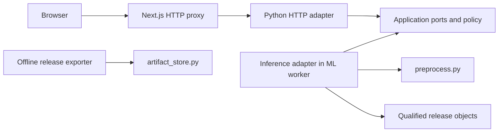
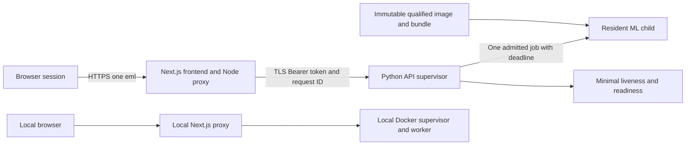

# Architecture Spine — PhishingEmailDetection

Hosting update 2026-10-19: the current cleanup supersedes the earlier deployment selection. The demo runs locally and future hosting is unspecified. This update does not validate unrelated original product requirements, E0 or phishing-only quality.

Pipeline update 2026-10-20: the offline pipeline follows the 19-10 upstream version (phishing-only target mode, schema-2 `run_manifest.json`, validation-selected thresholds, BERT candidate). AD-1 through AD-13 are unchanged; the resulting gaps and BERT question are recorded under Deferred.

Explanation update 2026-10-24: AD-14 adds an exact per-result factor explanation; AD-5 and AD-8 now admit it. Presentation of dataset-shortcut factors is deferred to Q9.

## Design Paradigm

**Hexagonal architecture** [ASSUMPTION]: browser and HTTP adapters call application ports; a dedicated inference adapter wraps existing preprocessing and a qualified model release. The Python service owns classification. The frontend proxy owns server credentials and upstream normalization. The browser owns transient selection and presentation.

This spine governs the web feature; source requirements retain their acceptance criteria. `[ADOPTED]` records settled constraints; `[ASSUMPTION]` records fast-draft choices. Architecture finalization does not qualify the model, approve draft UX, or certify deployment.

## Invariants & Rules

### AD-1 — Dependency boundaries [ASSUMPTION]

- **Binds:** All units.
- **Prevents:** Independent inference implementations and pipeline side effects inside HTTP requests.
- **Rule:** HTTP/framework adapters depend on application ports. Application policy has no frontend or framework dependency. Only the inference adapter imports `preprocess` and loads release objects. Request paths never import `train.py`, `evaluate.py`, `load_data.py` or `analyze_feature_importance.py`; they never train, fit, publish artifacts or run evaluation. Offline export may use `artifact_store.py`. Next.js is the frontend/proxy seed; FastAPI is the Python HTTP seed.



### AD-2 — Eligible, coherent release [ADOPTED]

- **Binds:** CAP-2, CAP-4, CAP-5; ML, exporter and runtime.
- **Prevents:** Renaming mixed positives as phishing or mixing artifacts from different runs.
- **Rule:** Real inference requires E0 evidence for target `legit_vs_phishing`: reviewed legitimate class `0` and evidenced phishing class `1`; ordinary spam and unknown positives are excluded. The observed mixed-positive run is ineligible until target-specific provenance and evaluation qualify a separate release. A disclaimer or changing `INCLUDE_SPAM` alone cannot qualify it. Export first verifies the full immutable training run, then packages exactly one explicitly selected classifier, its same-run Doc2Vec and scaler, and a deployment manifest. The manifest binds source-run ID/hash, source commit/revision, artifact hashes, ordered feature schema/dimensions, target/provenance, selected decision rule, code/resource hashes, complete environment lock, inference policy and release-specific evaluation evidence. ML owns the canonical `web/contracts/deployment-manifest.schema.json`, schema version `1`, including required E0 review/evidence references; exporter and runtime validate that identical schema. Offline team review qualifies eligibility; runtime metadata alone cannot establish it. Runtime verifies the approved bundle and loaded object dimensions/classes/resources before readiness. Missing evidence fails closed; no loose-file fallback or automatic classifier selection. Failed verification/publication preserves previous immutable runs and the selected pointer.

### AD-3 — Training-serving feature parity [ADOPTED]

- **Binds:** CAP-2, CAP-5; preprocessing, exporter and worker.
- **Prevents:** Different feature order, cleaned-input extraction or request-time fitting.
- **Rule:** Preserve original email bytes. Extract engineered features before text cleaning. Use ordered `preprocess.FEATURE_NAMES`; derive widths from the qualified manifest and loaded objects. Apply the release-frozen cleaning, stopword and optional lemmatization/resource policy; call the fitted scaler's `transform` only. Concatenate **Doc2Vec vector followed by scaled engineered features**. Reject nonfinite values, incompatible dimensions or predictions outside numeric `0|1`; map to `legit|phishing` only after AD-2. No request mutates trained weights or downloads resources. A Doc2Vec variable name does not establish its training mode.

### AD-4 — Repeatable inference [ASSUMPTION]

- **Binds:** CAP-2, CAP-5; ML worker and release qualification.
- **Prevents:** Different labels caused by shared RNG, request order or process restart.
- **Rule:** The deployment manifest specifies positive finite inference alpha/min-alpha, fixed epochs, process hash seed and deterministic seed derivation from release identity plus raw-content digest. Set `PYTHONHASHSEED` before worker imports; serialize RNG capture, deterministic reset, inference and restoration. Set native numerical thread counts explicitly to one for the initial profile. Qualification requires exact label repeatability across repeated input, reordered input and restart, and a recorded vector tolerance. Never infer settings from unverified saved defaults. Changing this policy creates a newly qualified release.

### AD-5 — One shared HTTP contract [ADOPTED; details ASSUMPTION]

- **Binds:** CAP-1 through CAP-4; browser, proxy and Python API.
- **Prevents:** Independent field names, success guesses and incompatible error handling.
- **Rule:** Python-owned schemas/OpenAPI and shared proxy-control/policy schemas are the contract source; generate client types and validate responses at runtime. Browser calls same-origin `POST /api/analyze`; proxy calls authenticated `POST /v1/analyze`. Multipart contains exactly one file field named `file`, with no extra fields/files. Proxy validates the original extension, then forwards canonical filename `message.eml`; the browser retains the actual filename. Strict success is `{"analysis_status":"completed","label":"legit"}` or its `phishing` equivalent, optionally with the AD-14 `explanation` object; no other fields. Each attempt generates a fresh browser UUIDv4 `X-Request-ID`; proxy validates its syntax and propagates it only as correlation, never authority. Missing/invalid IDs produce `INVALID_REQUEST` with a new proxy-generated ID. Every analysis response includes that header. Strict error is `{"error":{"code":"…","message":"safe English text"},"request_id":"…"}`, with no label. Proxy rejects invalid success envelopes and normalizes provider HTML, transport failures and backend authentication errors using the conventions below. HTTP adapters sanitize exception details.

### AD-6 — Shared bounded validation [ASSUMPTION]

- **Binds:** CAP-1, CAP-2; browser, proxy, parser and release policy.
- **Prevents:** Disagreement about accepted files and unbounded MIME/token processing.
- **Rule:** All units consume the same versioned policy; invalid/missing policy prevents deployment/readiness. Validate actual consumed bytes before unconstrained multipart parsing, not just `Content-Length`. Reject extra parts; client MIME type is never authoritative and suitability follows extension plus actual bytes/structure. The baseline accepts only a case-insensitive `.eml`, nonempty bytes, at least one nonempty recognized header (`From`, `To`, `Subject`, `Date`, `Message-ID`) and nonempty normalized text. Reject parser defects by default; any accepted defect must be explicitly listed in the qualified release policy. One release-owned validation/preprocessing adapter defines MIME traversal and tokenization; the proxy does not reimplement it. Count all parsed MIME nodes including root and attachment/nested-message nodes; root depth is zero and each child increments it. The decoded budget counts UTF-8 bytes of subject plus eligible decoded body text before normalization, excluding attachment/named-part payloads exactly as the release text extractor does. Token budget counts the final `preprocess.tokenize_text` token sequence after release-frozen cleanup/stopwords/lemmatization and before Doc2Vec; overflow rejects, never truncates. Missing-header/structure warning codes are internal transient verification data; retain no content or extra log fields. Parser, resource and useful-content rules are release-frozen. Changes require new compatibility evidence and an atomic shared-policy update.

### AD-7 — Admission and enforceable deadlines [ASSUMPTION]

- **Binds:** CAP-2 through CAP-4; supervisor, worker and deployment.
- **Prevents:** Unbounded queues, concurrent model mutation and model computations surviving the backend/proxy execution deadline.
- **Rule:** Run one ASGI supervisor with one resident, serial ML child created by portable process spawn. Acquire the sole analysis slot after authentication and before request consumption/parse; hold it through cleanup. Reject excess analyses immediately with `SERVICE_BUSY`, without a queue. Liveness remains responsive. The parent owns deadline-aware asynchronous body collection, request identity, monotonic deadline, request temporary directory and IPC. Multipart parsing, MIME processing, features and inference all run in the killable child; any spools use that parent-owned directory. On the backend deadline, terminate/reap the child, discard its IPC and clean parent-owned data before releasing capacity. Allow 1s for termination/reap, then hard-kill and allow 1s for reap. If still alive, supervisor exits nonzero so container restart owns recovery; never spawn a replacement alongside an unreaped child. Child-created descendants are prohibited. Remain unready until the replacement child validates/loads the release. Client abort, proxy timeout and Uvicorn keep-alive never substitute for stopping computation. Late/disconnected responses cannot commit another request's result.

### AD-8 — Browser attempt state [ADOPTED; draft UX details remain assumptions]

- **Binds:** CAP-1, CAP-3; frontend state and result components.
- **Prevents:** Automatic upload, stale labels and errors becoming a third class.
- **Rule:** Use the five states `no-file`, `file-selected`, `analyzing`, `success`, `error`. Before Analyze, show the selected filename/size. Selection transmits nothing; explicit Analyze captures an immutable file/attempt identity. Only the current, schema-valid attempt may commit a result. Replace, remove, timeout and reset invalidate old attempts and clear prior labels. Prevent overlapping attempts; apply the shared bounded manual Retry policy. Display English `Legit` or `Phishing` with text as well as color, and the captured filename. Errors carry no class. Observe phases under AD-13; use “Analyzing…” when no reliable phase exists. Never invent percentage/stage progress or promise server cancellation. Show AD-14 factors only inside the current success result and clear them with it. Score, inspector, history and account screens remain outside this MVP.

### AD-9 — Transient data and safe processing [ADOPTED]

- **Binds:** All units; storage, logs and inference.
- **Prevents:** Retained email data and execution/fetching of email content.
- **Rule:** Browser files/results live in session memory only; refresh clears them. Raw uploads and derived text are bounded transient data. Parent-owned spools/IPC are removed on success, rejection, failure, timeout and restart; startup clears abandoned request spools. No database, email-result persistence, local storage or content analytics. Logs use only request ID, bytes, duration, status and internal release ID; omit filename, subject, sender, recipient, raw content and content digests. Never render uploaded HTML, execute scripts/attachments, open links, or make URL/DNS/WHOIS/tracking requests. Deserialize only team-controlled release artifacts; never deserialize uploads. Hash integrity is separate from pickle trust.

### AD-10 — Credentials and access envelope [ADOPTED; deployment access gate ASSUMPTION]

- **Binds:** Proxy, backend and deployment.
- **Prevents:** Browser-exposed credentials and ineffective distributed abuse controls.
- **Rule:** Backend verifies `Authorization: Bearer` with an environment-scoped secret; proxy reads server-only `ML_API_TOKEN` and `ML_API_URL`. No secret in `NEXT_PUBLIC_` variables, client bundles, logs or response bodies. Cloud links use TLS; browser traffic is same-origin. CORS is not authentication. Initial acceptance is a controlled demo; local fallback binds the proxy to loopback. Cloud publication requires a provider-supported server-side access gate verified for the account/tier. Anonymous public publication requires independently verified shared abuse control; per-instance counters are insufficient. No login/account flow is added to the MVP.

### AD-11 — Immutable environment, readiness and rollback [ADOPTED; packaging ASSUMPTION]

- **Binds:** CAP-4 through CAP-6; exporter, operations and runtime.
- **Prevents:** Workstation-dependent imports, cold-start mutations and incompatible rollback.
- **Rule:** Build a self-contained locked Linux image containing the qualified three-artifact bundle, manifest, matching preprocessing code and required resources. Resolve an absolute release root once; pin one release per deployment. Model files are read-only; temporary request storage is bounded and disposable. No sibling virtualenv fallback, request-time installation/download or polling `current.json` for hot swaps. Model objects load only in the ML child, not twice in the supervisor. `GET /health/live` returns 200 `{"status":"alive"}` when the supervisor is responsive. `GET /health/ready` returns 200 `{"status":"ready"}` only when policy and the eligible child are usable, otherwise 503 `{"status":"unready"}`; busy capacity does not imply unready. Health endpoints expose no model details and do not run inference. Deployments/rollback move code, model, resources and policy together; retain the last qualified release and its evidence.

### AD-12 — Local operation and future hosting qualification [ADOPTED; hosting unspecified]

- **Binds:** CAP-6; deployment and handover.
- **Prevents:** Unsupported cloud availability claims and unreachable local fallback.
- **Rule:** Use the Next.js Node Route Handler proxy and separate Python service locally. The PRD’s approximately 400 MiB peak-RAM assumption remains a future, unqualified research target. It is not a memory cap or guarantee for the current local legacy demo, and no measurement is claimed. Future hosting is unspecified and requires measured whole-process/container cold/steady/request memory, startup, warm/cold latency, complete multipart transfer, overload, deadlines, recovery, access and restart persistence. Keep code/models/resources/policy coherent. A remote frontend needs a reachable backend; local operation includes the local frontend/proxy. Do not silently select a paid plan/trial, required GPU, database or keepalive cron. Local evidence does not certify future hosting.

### AD-13 — Truthful progress observation [ASSUMPTION]

- **Binds:** CAP-3, FR-5; browser, proxy and supervisor.
- **Prevents:** Fabricated phase text or progress metadata widening the classification response.
- **Rule:** Browser upload events may report “Sending email…”. A separate same-origin `GET /api/analysis-status?request_id=<uuid>` proxies authenticated `GET /v1/analysis-status?request_id=<uuid>`. The query carries the original analysis ID; this GET requires no `X-Request-ID` input header. Its response ID/header equals the query. Strict 200 status shape is `{"request_id":"…","phase":"unknown"}`, with phase enum `unknown|starting|receiving|processing`. `starting` is service-wide and may be reported for any valid query only while the supervisor is actually initializing/recovering its child. `receiving` means the matching active analysis is consuming its body; `processing` means its worker job has started. A different/no active ID otherwise yields `unknown`. Keep only current active correlation/phase in RAM and erase it on completion/failure; no label, filename, history or email data in this channel. Poll only during the current attempt, every 2s, at most 75 times and within its deadline; each poll times out after 3s, with no overlapping polls. Stop polls on every terminal/invalidation path. Same access gate, UUID syntax, credential and response-validation rules apply. Status/health do not occupy the analysis slot. Provider cold wake or unavailable status without a reliable phase uses generic “Analyzing…”, never an inferred startup message. A failed poll cannot fail or commit the analysis; only its terminal POST response does.

### AD-14 — Exact factor explanation [ADOPTED; catalogue wording and strength bands ASSUMPTION]

- **Binds:** CAP-2, CAP-3, CAP-5; ML worker, HTTP contract and browser result.
- **Prevents:** Explanations that disagree with the served decision, leak email content, vary across repeats or read as proof or confidence.
- **Rule:** The ML child computes exact additive contributions of the served classifier's decision margin for the same vector that produced the label (tree ensembles: XGBoost `pred_contribs`). It sums the Doc2Vec dimensions into one `text_content` factor and keeps each engineered feature as its own factor, named by `preprocess.FEATURE_NAMES`. Startup verifies on the release's test arrays that contributions plus bias reproduce the margin within 1e-3; a per-request mismatch returns `INTERNAL_ERROR` with no result. The response carries 1–5 nonzero factors with the largest absolute contribution, ordered descending (ties in feature order, text first), each `{factor, direction, strength}`: `direction` is `positive` or `negative` relative to class 1; `strength` is |contribution| divided by the largest shown, rounded to two decimals in (0, 1]. Factor IDs and English display text come from the versioned `web/contracts/explanation-factors.json`; readiness fails if a served feature lacks an entry. A release whose classifier has no exact method omits `explanation`; no LIME, sampling or surrogate model. Factors are result data: transient, never logged, absent from the status channel and errors, and covered by AD-4 repeat/reorder/restart checks. Changing the method, grouping or catalogue is a contract change.

## Consistency Conventions

The following choices form the initial **[ASSUMPTION] policy**, not measured SLAs. API/deployment owners must qualify them before E2/E4; changes update one contract artifact and all consumers together.

| Concern | Binding convention |
| --- | --- |
| File/body limits | File: 2,097,152 bytes (2 MiB including encoded attachments). Entire multipart body: 2,162,688 bytes. Enforce independently at browser/proxy/backend; reject actual overrun. |
| MIME/work limits | At most 100 MIME parts, depth 20, 2,097,152 decoded subject/body bytes and 50,000 normalized tokens; defects rejected unless release-policy allowlisted. |
| Initial deadlines | Browser attempt: 165s from Analyze activation. Proxy: 150s from handler entry, including upload/validation/cold wake. Worker startup/recovery: 120s from spawn. Backend: min(60s from admission, remaining trusted proxy deadline minus 4s reserve), using a monotonic timer. The reserve separately allows 2s measured inter-host clock skew and 2s termination/reap. Proxy replaces any caller deadline with its UTC epoch-millisecond `X-Analysis-Deadline`; authenticated backend validates it, clamps to its local bound and rejects expired budgets as `ANALYSIS_TIMEOUT`. Browser timeout may precede proxy expiry; it invalidates the attempt without promising immediate server stop. The trusted proxy deadline still bounds backend computation. Startup timeout leaves unready. |
| Retry | Manual only; at most two retries per unchanged selected file, counted across Retry/Analyze activations after failure. `SERVICE_BUSY`, `MODEL_UNAVAILABLE`, `UPSTREAM_UNAVAILABLE`, `UPSTREAM_INVALID_RESPONSE`: wait 5s; `ANALYSIS_TIMEOUT`, `INTERNAL_ERROR`: wait 10s. Proxy emits matching `Retry-After` seconds. Input errors require replacement/correction. Exhausted Retry has a textual explanation; no alternate Analyze action bypasses the same-file count. Success/replacement clears retry state. |
| IDs/schema | Fresh UUIDv4 per attempt, syntactically validated and used only for correlation; exact lowercase labels; no success extras beyond the AD-14 explanation. Backend/contract owner supplies schemas, status/error enum, retryability and policy. Generated frontend types do not replace runtime validation. |
| Error HTTP map | `INVALID_REQUEST` 400 (multipart/extension/extra parts); `EMAIL_TOO_LARGE` 413; `EMPTY_EMAIL`, `INVALID_EMAIL`, `INSUFFICIENT_CONTENT`, `RESOURCE_LIMIT` 422; `SERVICE_BUSY` 429; `MODEL_UNAVAILABLE`, `UPSTREAM_UNAVAILABLE` 503; `ANALYSIS_TIMEOUT` 504; `UPSTREAM_INVALID_RESPONSE` 502; `INTERNAL_ERROR` 500. Errors never contain a class. |
| Upstream normalization | Unreachable/startup 503 → `UPSTREAM_UNAVAILABLE`; transport deadline → `ANALYSIS_TIMEOUT`; backend auth failure, unexpected status or invalid/non-JSON success → `UPSTREAM_INVALID_RESPONSE`. Valid canonical backend errors pass through with the proxy request ID. Provider bodies never reach the browser. |
| Control plane | Release/inference policy is packaged and hash-bound; transport/admission policy is versioned with the deployment. Startup validates bounds and `backend < proxy < browser`; qualification records observed application timing. |
| Starter options | Use `create-next-app@16.3.8` with explicit TypeScript, ESLint, Tailwind and App Router; no `src/` directory, no React Compiler, alias `@/*`. Retain the lockfile and record actual resolved versions; do not rely on saved CLI defaults. |
| Environments | Separate local, preview and production secrets/endpoints; preview does not inherit production credentials. Frontend project root is `web/frontend/`; corpus/training artifacts stay outside its build. |
| E0 qualification | Reviewed dataset/per-source evidence; verified same-run hashes, classes, widths and matching test counts; privacy-scrubbed plain-text/HTML/multipart/charset/attachment/malformed `.eml` fixtures; bytes-to-prediction harness/API engineered-feature equality, embedding tolerance and label agreement; initial peak RAM/startup/warm/cold measurements. Deduplicate before split, use separate validation for classifier/threshold selection and an independent appropriately grouped test partition; training-only scaler fit. ROC-AUC/thresholds use the confirmed positive-class index/scores; classification metrics use labels. Retain target-specific FP/FN and complete case/failure counts. |
| Contract acceptance | Mock/sample responses are visibly marked “Sample result — not a real analysis” and cannot satisfy E0/real-model acceptance. Real-model email fixtures provide qualification evidence. Qualify parser edge cases, repeat/order/restart determinism, observed progress, stale attempts, timeout/reap/cleanup and provider failure normalization. Preserve existing unittest obligations; report actual checks rather than assuming they pass. Qualify explanation additivity, factor repeatability across repeat/order/restart, catalogue coverage, and absence of factors in errors, logs and status responses. |
| Delivery gates | E1 design/sample work may overlap E0; E2 qualification and E3 real-browser prediction use an eligible release. E4 requires measured container and actual multipart/warm/cold/unavailable/timeout/recovery behavior. E5 requires frontend build and meaningful inference/API/browser upload/drop/change/retry/error checks, sensitive-log/secret/temp-cleanup inspection, measurements with case count/size/environment, and tested local Docker run/deploy/rollback instructions. Local/sample/architecture evidence does not certify E0 or cloud acceptance. |

## Stack

Seed verified on 2026-10-05; package pins are **[ASSUMPTION]**, uninstalled/unbuilt. Full dependency locks and Linux/model compatibility are E0/E2 evidence. Code owns this seed after implementation.

| Name | Version |
| --- | --- |
| create-next-app / Next.js | 16.3.8 |
| Node.js | Local target 24.21.0 LTS; Node 24.x |
| React / React DOM | 19.2.8 / 19.2.8 |
| TypeScript | 5.9.3 (starter 5.x line; current stable 7.0.2) |
| Tailwind CSS / PostCSS plugin | 4.3.3 / 4.3.3 |
| Python container | Official `python:3.11.17-slim-bookworm`, resolved image digest recorded at build |
| FastAPI | 0.142.2 |
| Uvicorn | 0.54.0 |
| python-multipart | 0.0.32 |
| ML/runtime dependencies | E0-certified exact lock; observed Windows versions are evidence only, not a portable artifact baseline |

Primary version/fit links are retained in [frontend/hosting research](.working/frontend-hosting-research.md) and [Python service research](.working/python-service-research.md). Local metadata and actual code drift are in [brownfield audit](.working/brownfield-audit.md). No stack build, model loading or deployment was performed.

## Structural Seed



```text
PhishingEmailDetection/
  web/
    frontend/               Next.js page, upload/state UI, /api/analyze
    backend/                application ports, HTTP supervisor, worker, inference adapter
    contracts/              backend-owned OpenAPI/client generation and policy schema
    docs/                   portable handover snapshots; canonical sources remain below
    scripts/                handover snapshot refresh
  deployment/               offline release export, image and run/rollback instructions
  preprocess.py             existing feature/text implementation, frozen per release
  artifact_store.py         existing full-run verifier used offline
  train.py, evaluate.py      existing offline scripts; excluded from request imports
  _bmad-output/             source requirements, UX, spine and evidence
```

No result datastore or email inspector is seeded. Existing offline script drift is recorded in the audit; architecture does not claim that immutable-run publication or guarded evaluation is already integrated.

## Capability → Architecture Map

| Capability | Lives in | Governed by |
| --- | --- | --- |
| CAP-1: one email submission | Browser, proxy, HTTP admission/parser | AD-5, AD-6, AD-8, AD-9 |
| CAP-2: eligible binary prediction | Qualified release, inference worker | AD-1 through AD-7, AD-9, AD-14 |
| CAP-3: progress/recovery | Browser reducer, proxy normalization, supervisor/status | AD-5, AD-7, AD-8, AD-13 |
| CAP-4: readiness/attribution | Export manifest, supervisor, private logs | AD-2, AD-5, AD-7, AD-9, AD-11 |
| CAP-5: reproducible release | ML qualification, offline exporter, image lock | AD-2, AD-3, AD-4, AD-11, AD-14 |
| CAP-6: demonstration/handover | Frontend/backend deployment and validation evidence | AD-9 through AD-12, contract acceptance |

## Deferred

| Item / owner | Revisit condition and boundary |
| --- | --- |
| Eligible dataset, classifier, quality criteria, exact inference values/resources and vector tolerance — ML | Before E0/real predictions. Release fields and eligibility are mandatory under AD-2/3/4; mock/sample responses may unblock contract/UI work only. No phishing-only accuracy is asserted. |
| Initial validation/deadline profile — API + deployment | Before E2/E4 acceptance, measure and jointly qualify or revise the explicit profile above. Shared ownership is fixed; builders cannot choose separate limits. |
| Free-host account fit and cloud access protection — deployment | Before Internet publication/E4. Verify tier eligibility and provider protection, whole-container measurements and real cold/warm behavior; otherwise use loopback local fallback under AD-10/12. Anonymous publication waits for shared abuse controls. |
| UI composition, exact tokens, focus and responsive refinements — UX/frontend | Draft UX A1–A5 remain editable before UI acceptance; explicit Analyze, readable binary labels and attempt safety stay binding. |
| Offline pipeline completion — ML implementation | Before generating/qualifying a new release, restore the missing 19-10 upstream modules/functions (Q7), make `analyze_feature_importance.py` read the release's embedding width instead of hardcoding 100, and have the offline exporter translate the schema-2 `run_manifest.json` into the AD-2 deployment manifest. The current web verifier reads `manifest.json` and cannot load schema-2 runs. Never import those scripts into the service. |
| BERT classifier candidate — ML + architecture | Before selecting a BERT release (Q8). AD-1/AD-3/AD-4 assume Doc2Vec + scaled engineered features with one classifier; BERT needs a new AD for its text policy, windowing/aggregation, GPU-free CPU resources, determinism and parity before it can serve. |
| Dependency transitive pins, generated schema filenames, internal class/function names — implementation | Resolve through one locked build/contract owner at E1/E2; follow the boundaries above. No independent alternative wire formats. |
| Scores, raw feature values, inspector, persistence, scaling and extra delivery material — product | Only upon new scope approval; no dormant MVP fields, datastore or extra screen. AD-14 factor explanations were approved on 2026-10-24. |
| Dataset-shortcut factors (Q9) — ML + UX | Before FR-11 acceptance, decide whether `is_html` and similar source-format features are retrained away, disclosed as known dataset bias in the catalogue, or excluded; any exclusion must itself be disclosed. |
